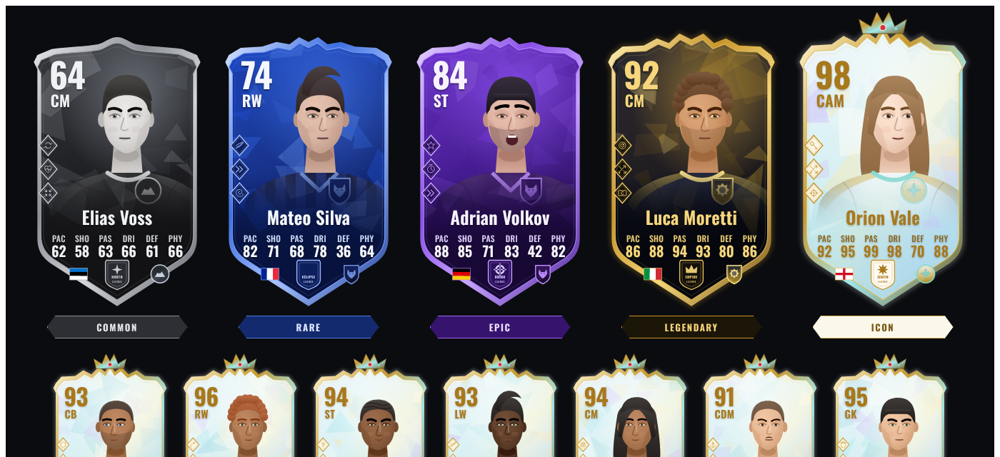

# FOOTBALL DRAFT

サッカー選手のドラフトとチーム編成で戦う、最大4人のオンライン対戦ゲーム。
設計書：`docs/` 配下（現状分析・開発計画・決定事項・SIM仕様・実装記録）。



## 構成

| ディレクトリ | 内容 |
| --- | --- |
| `packages/shared` | 型・選手生成（架空240人）・スネークドラフト・自動指名・編成・ケミストリー・試合SIM・リーグ順位・通信の型 |
| `packages/ui` | 選手カード（参考画像のデザイン）・SVGイラスト肖像・国旗・クラブ紋章・特性アイコン |
| `apps/api` | ゲームのバックエンド。Cloudflare Workers（Hono）＋ D1 ＋ Durable Objects（`RoomDO`：ルーム・ドラフト・試合の進行をサーバーで確定） |
| `apps/web` | ゲーム本体（React＋Vite） |
| `apps/admin` | FOOTBALL DRAFT ADMIN（運営管理サイト。管理者専用認証） |

## ローカルで動かす

必要なもの：Node.js 20 以上（22推奨）

```bash
npm install

# 1. APIの準備（初回のみ）
cp apps/api/.dev.vars.example apps/api/.dev.vars   # WS_TICKET_SECRET をランダムな値に変更
npm run db:migrate:local                            # テーブル作成＋選手240人を投入

# 2. 起動（それぞれ別のターミナルで）
npm run dev:api     # http://127.0.0.1:8787
npm run dev:web     # http://127.0.0.1:5173  ゲーム
npm run dev:admin   # http://127.0.0.1:5174  管理サイト

# 3. 管理者アカウントの作成（管理サイトを使う場合）
npm run admin:create:local -- --username あなたの管理者名
#   パスワード（12文字以上）を聞かれます。
#   表示される TOTP シークレット / otpauth URI を認証アプリ（Google Authenticator 等）に登録してください。
#   ローカル確認だけなら --no-totp で2段階認証なしのアカウントも作れます（ローカル限定）。
```

ゲームは `http://127.0.0.1:5173` で新規登録 → 「クイックドラフト」または「ルームを作成」。
1人でも開始でき、空席はCPUが埋めます。友だちとは招待コード・招待リンクで同じルームに入れます。

## テスト

```bash
npm test -w @fd/shared          # 単体テスト（乱数・選手データ・ドラフト・編成・SIM・順位）
npm run sim:balance -- 150      # SIMのバランス検証（大量の自動試合）
npm run e2e -w @fd/api          # API起動中に実行：4人のWebSocketクライアントでリーグを1回通しで対戦
npm run typecheck
```

## デプロイ（未実施）

`apps/api/wrangler.toml` に dev / staging / production の環境を定義済み。デプロイ前に次が必要です。

1. 環境ごとに D1 データベースを作成し、`database_id` を設定（`wrangler d1 create football-draft-production` など）
2. `wrangler d1 migrations apply DB --remote --env <env>`
3. `wrangler secret put WS_TICKET_SECRET --env <env>`
4. `ALLOWED_ORIGINS` にゲーム・管理サイトの公開URLを設定し、`apps/web` / `apps/admin` をビルドして配信（`VITE_API_URL` にAPIのURL）
5. 試合SIMとCPUの自動指名はCPU時間を使うため、Workers は有料プランを推奨

## ドキュメント

- `docs/00-phase0-report.md` 現状分析
- `docs/01-dev-plan.md` 開発計画
- `docs/02-decisions.md` 決定事項・暫定値・提案中の事項
- `docs/03-sim-v0.1.md` 試合シミュレーションの仕様とバランス検証結果
- `docs/04-implementation-log.md` 実装記録（実装済み・未実装・検証結果・既知の課題）
